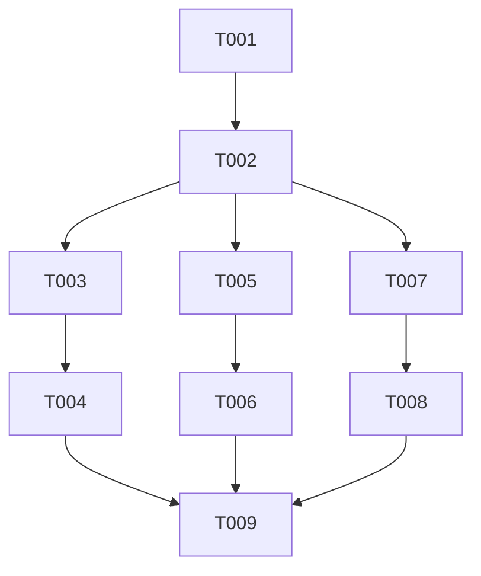

# Tasks: Exit Relay Operations and Policy Review

**Input**: Design documents from `specs/003-exit-relay-operations/`

**Prerequisites**: `plan.md`, `spec.md`, `research.md`, `data-model.md`, and `quickstart.md`. No contracts are defined for this documentation-only feature.

**Tests**: No automated tests were requested. Each story has an independent manual verification criterion; the final phase walks through `quickstart.md`.

**Organization**: Tasks are grouped by the three prioritized user stories in `spec.md`. All implementation tasks update the shared `ANSIBLE_RUNBOOK.md`, so the documentation edits should be applied sequentially even though the story checks are independently verifiable.

## Format: `[ID] [P?] [Story] Description`

- **[P]**: Can run in parallel without editing the same file or depending on incomplete tasks
- **[Story]**: User story label for story-specific work
- Each task names its target file path

## Phase 1: Setup

**Purpose**: Establish the focused location for the operational procedures in the existing runbook.

- [X] T001 Add a `Tor Exit Operations (tor03)` section with subsections for exit policy, abuse handling, and identity/provider readiness in `ANSIBLE_RUNBOOK.md`.

---

## Phase 2: Foundational

**Purpose**: Define shared scope and result vocabulary before recording story-specific checks.

- [X] T002 Add a short scope and status note in `ANSIBLE_RUNBOOK.md`: cover the seven configured ports, keep policy changes subject to separate approval, set no response-time target, use statuses `verified`, `not supported`, `unavailable`, and `unresolved`, and exclude Tor-user activity and private provider evidence or references.

**Checkpoint**: The runbook has a consistent scope and status vocabulary; story work can proceed.

---

## Phase 3: User Story 1 - Review allowed exit services (Priority: P1) 🎯 MVP

**Goal**: Explain the rationale and retain a dated, transport-aware reachability result for every configured exit port.

**Independent Test**: A reviewer can find all seven ports in `ANSIBLE_RUNBOOK.md`; each has an intended service, rationale, keep-or-change decision, direct TCP check from tor03, result, check date, and follow-up when needed. A direct node-level check is sufficient; no end-to-end Tor-client test is required and no active policy was changed.

### Implementation for User Story 1

- [X] T003 [US1] Compare `group_vars/all/tor` with the policy rendered by `roles/tor-exit/templates/torrc`; add one review row per port in `ANSIBLE_RUNBOOK.md` for ports 53, 80, 443, 993, 995, 1194, and 11371, recording intended service, rationale, decision, and any unresolved purpose.
- [X] T004 [US1] Check each listed service by direct connection from tor03 and record the destination, transport, location, result, date, and follow-up in `ANSIBLE_RUNBOOK.md`; use TCP, test DNS resolution separately from TCP destination port 53, identify whether OpenVPN on port 1194 is TCP or UDP, and treat direct node-level results as sufficient without an end-to-end Tor-client test.

**Checkpoint**: The seven policy entries and their reachability results are individually reviewable without changing the active exit policy.

---

## Phase 4: User Story 2 - Handle exit abuse notices (Priority: P1)

**Goal**: Give an operator an actionable path from notice intake through response and provider escalation while minimizing stored information.

**Independent Test**: A reviewer unfamiliar with current response practices follows a hypothetical notice through intake, triage, response, and escalation decision using `ANSIBLE_RUNBOOK.md` alone, completes the walkthrough within 10 minutes, and confirms the procedure sets no response-time target and requires no user-traffic or destination logging.

### Implementation for User Story 2

- [X] T005 [US2] Check the operational notice intake route using the existing contact configuration in `roles/tor-exit/templates/torrc` and `roles/base/templates/aliases`; document intake, triage, response steps, and the minimum operational note in `ANSIBLE_RUNBOOK.md`, recording unresolved route details as follow-up rather than inferring receipt from configuration alone, and without copying full complaint content or setting a response-time target.
- [ ] T006 [US2] Document provider escalation triggers, the contact route, operational information to provide, and how to record the outcome in `ANSIBLE_RUNBOOK.md`; time a hypothetical notice walkthrough for a maintainer unfamiliar with current practices and record whether it completes within 10 minutes, then remove any step that asks operators to collect Tor-user identity, destinations, traffic content, or connection history. (Procedure documented; timed maintainer walkthrough remains pending.)

**Checkpoint**: An operator can handle a sample notice consistently while preserving the project's user-data minimization boundary.

---

## Phase 5: User Story 3 - Verify hosting and network identity (Priority: P2)

**Goal**: Record dated public identity results and provider readiness statuses without exposing confidential provider material.

**Independent Test**: A reviewer finds dated reverse-DNS and applicable WHOIS/registration results, plus separate dedication, provider-permission, and provider-support statuses in `ANSIBLE_RUNBOOK.md`; unsupported, unavailable, or unresolved checks are explicit and no private provider evidence or references appear.

### Implementation for User Story 3

- [X] T007 [US3] Check tor03 reverse DNS and applicable WHOIS or equivalent public registration records; document the public result, date, relay-identity assessment, and any unsupported/unavailable status in `ANSIBLE_RUNBOOK.md`.
- [X] T008 [US3] Check the provider account/terms or support channel for dedicated-host status, permission to operate a Tor exit relay, and provider support/contact route; record only each item's status, date, and non-sensitive follow-up in `ANSIBLE_RUNBOOK.md`, without private evidence details or references.

**Checkpoint**: Public identity and provider readiness can be reviewed separately, and no provider-specific support is inferred from repository configuration alone.

---

## Phase 6: Polish & Cross-Cutting Concerns

**Purpose**: Confirm the complete runbook meets all acceptance criteria and stays within the approved scope.

- [X] T009 Walk through every completion check in `specs/003-exit-relay-operations/quickstart.md` against `ANSIBLE_RUNBOOK.md`; fix missing or contradictory guidance, verify the seven ports and status vocabulary, and confirm no active Tor configuration was changed. (The separate timed maintainer usability check remains pending under T006.)

---

## Dependencies & Execution Order

### Phase Dependencies

- **Setup (Phase 1)**: T001 establishes the runbook section.
- **Foundational (Phase 2)**: T002 depends on T001 and blocks all story documentation.
- **User Stories (Phase 3+)**: US1, US2, and US3 each depend on T002. Their checks are conceptually independent, but their runbook edits are serialized because they all update `ANSIBLE_RUNBOOK.md`.
- **Polish (Phase 6)**: T009 depends on T003–T008.



### User Story Dependencies

- **US1 (P1)**: Depends on T001–T002; no dependency on another story. Tasks T003 then T004.
- **US2 (P1)**: Depends on T001–T002; no dependency on another story. Tasks T005 then T006.
- **US3 (P2)**: Depends on T001–T002; no dependency on another story. Tasks T007 then T008.

### Parallel Opportunities

- No tasks are marked `[P]`: every implementation task edits the same runbook, so parallel edits would conflict.
- The external checks within US3 (public DNS/registration lookups and provider account review) may be gathered independently, then recorded together in T007–T008.
- Stories can be verified independently after the foundational scope/status note, but runbook edits should be applied sequentially.
- **US1**: No parallel task pair; T003 establishes the review rows before T004 records their results.
- **US2**: No parallel task pair; T006's walkthrough depends on the procedure written in T005.
- **US3**: Public record and provider checks are independent evidence-gathering activities, but the documented task edits T007 and T008 are serialized because both update the same runbook.

## Parallel Example: User Story 3 Checks

The two evidence-gathering activities below can be performed independently, but their results are written into the shared runbook sequentially:

```text
Public reverse-DNS and registration lookup → T007 → ANSIBLE_RUNBOOK.md
Provider terms/account review → T008 → ANSIBLE_RUNBOOK.md
```

## Implementation Strategy

### MVP First (User Story 1)

1. Complete T001–T002 to establish the runbook section and shared constraints.
2. Complete T003–T004 to review all seven configured ports and their reachability.
3. Verify the US1 independent test. Keep any recommended exit-policy change separate from this issue's rollout.

### Incremental Delivery

1. Deliver the reviewed exit policy and transport-aware checks (US1).
2. Add and independently walk through abuse response and provider escalation (US2).
3. Add dated public identity checks and provider readiness statuses (US3).
4. Complete T009 against the full quickstart and all user-story acceptance criteria.

## Notes

- `[P]` is omitted because all runbook implementation tasks target the same file.
- Story labels map tasks to the acceptance scenarios in `spec.md`.
- Manual operational checks are required by the feature; automated test tasks were not requested.
- A failed or unavailable check is recorded with its scope and follow-up, not converted into an unsupported claim.
- No task changes `group_vars/all/tor`, `host_vars/tor03.mtak.nl`, or `roles/tor-exit/templates/torrc`.
